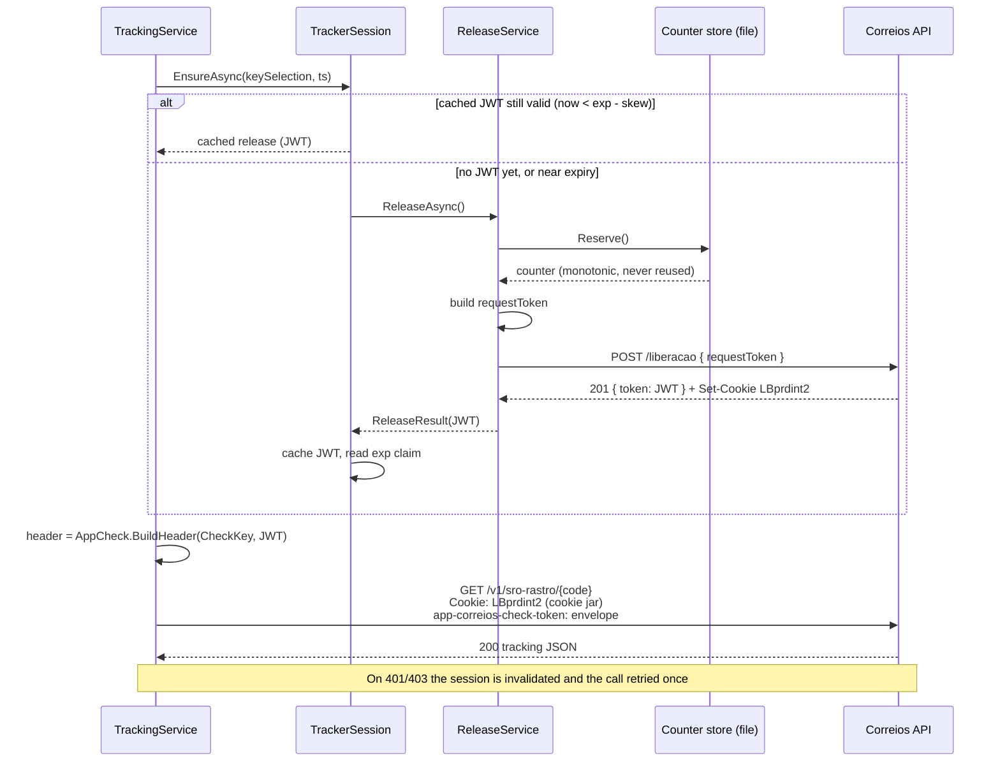
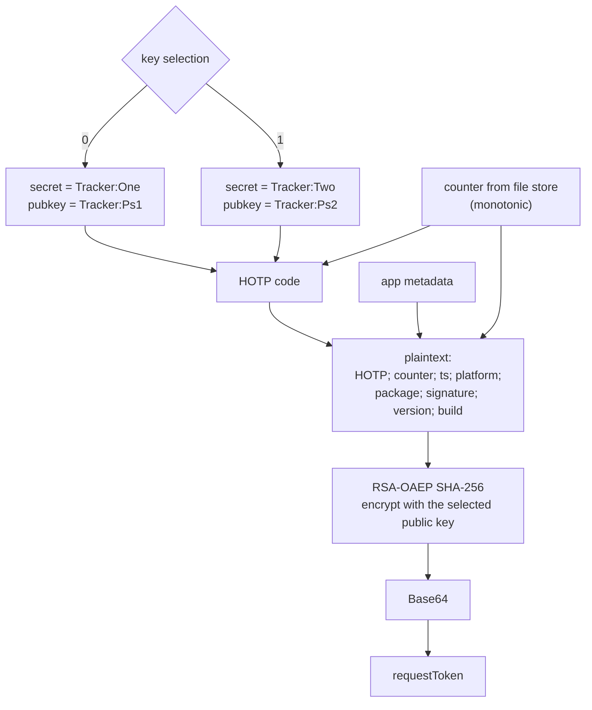
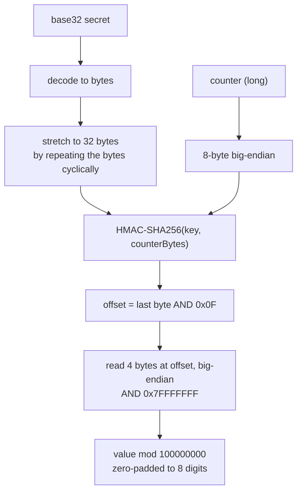
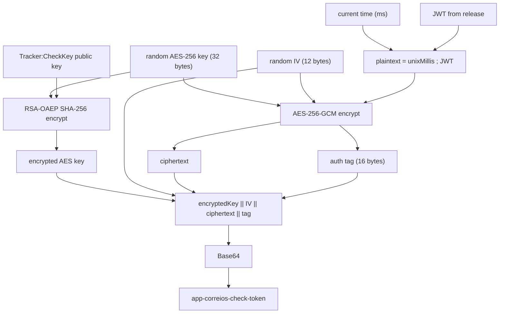

# CorreiosAPI

A .NET client that talks to the Correios mobile tracking API the same way the official app does. It reproduces the app's authentication so a plain HTTP client is accepted by the backend, then looks up a tracking code and renders the events as a terminal timeline.

The library lives in `src/Tracker`, the command-line front end in `src/Tracker.Cli`, and a Python reference of the original handshake in `legacy/`.

## How authentication works

The backend does not accept an anonymous request. Before it answers a tracking lookup it wants two things:

1. Proof that the caller is the real app, sent once to get a session. This is the release step, `POST /v4/app-validation/liberacao`, which returns a short-lived JWT and a session cookie.
2. A fresh proof on every later request that the caller still holds that JWT and is sending the request now, not replaying an old one. This is the `app-correios-check-token` header.

Both proofs are built with public-key crypto. The client only ever holds public keys; it encrypts toward the server, and only the server, which holds the private keys, can open what the client sent. So the secrets never have to travel, and a captured request cannot be decrypted or forged by anyone without the private key.

The two phases map to two header mechanisms and two separate keys. The release uses an HOTP code plus an RSA-encrypted request token. The per-request check uses an RSA and AES-GCM envelope over the JWT and the current time.

### The whole flow



The session cookie `LBprdint2` is a load-balancer stickiness cookie. The HTTP client keeps a cookie jar, so the cookie from the release response is resent automatically and followed if the server rotates it. Nothing attaches it by hand.

## The release request token

The release proves the caller is the app. The proof is a `requestToken`: a plaintext string, RSA-encrypted. The plaintext is eight fields joined by semicolons:

```
HOTP ; counter ; timestamp ; platform ; packageName ; buildSignature ; version ; buildNumber
```

The last five fields are app metadata that has to match a real build. The first two are the moving parts that stop replay: a counter that only ever goes up, and an HOTP code derived from that counter and a shared secret.



There are two interchangeable credential sets, picked by the `keySelection` argument (`0` or `1`). Selection `0` uses the secret `Tracker:One` with public key `Tracker:Ps1`; selection `1` uses `Tracker:Two` with `Tracker:Ps2`. The secret and the key always move together. See `src/Tracker/Session/RequestToken.cs`.

### The counter

The counter has to move forward on every release and never repeat a value, even after the process restarts, because the server tracks it per credential and rejects a value it has already seen or one that moves backward. `FileCounterStore` keeps it in a single file and reserves a value by opening the file with `FileShare.None`, reading the current value, writing the next one back, and flushing to disk before it returns. The lock means two processes cannot hand out the same number. See `src/Tracker/Session/FileCounterStore.cs`.

Because a release burns a counter value, the client does not release on every tracking call. It caches the JWT and reuses it until the JWT is near expiry, which keeps the counter sequence close to what the real app would produce. More on that below.

### The HOTP code

HOTP is the HMAC-based one-time password from RFC 4226, with HMAC-SHA256 in place of SHA-1 and an eight-digit output. It turns the counter and the shared secret into a code the server can recompute and check. See `src/Tracker/Session/Hotp.cs`.



The one unusual step is the key. The decoded base32 secret is stretched to exactly 32 bytes by repeating its bytes in a cycle, and that 32-byte key is what feeds the HMAC. The rest is standard dynamic truncation: the low nibble of the last digest byte picks an offset, four bytes are read from there as a big-endian integer, the top bit is masked off, and the result is reduced to eight decimal digits.

### The response

A successful release is HTTP 201 with a JSON body `{ "token": "<JWT>" }` and a `Set-Cookie: LBprdint2=...` header. The JWT is the session credential for everything that follows. Its `exp` claim sets how long the session lasts. See `src/Tracker/Session/ReleaseService.cs`.

## The per-request app-check header

Every request after the release carries an `app-correios-check-token` header. It binds the request to the current JWT and to the moment it is sent, so an old header cannot be replayed. A new one is built for each request, with a fresh timestamp, a fresh AES key, and a fresh IV. See `src/Tracker/Session/AppCheck.cs`.

The plaintext is just the current time in Unix milliseconds and the JWT, joined by a semicolon:

```
unixMillis ; JWT
```

That plaintext is sealed in a hybrid envelope. A random AES-256 key encrypts the plaintext under AES-GCM, and that AES key is itself encrypted under the server's RSA public key. The server opens the RSA layer with its private key to recover the AES key, then opens the GCM layer to read the plaintext, check that the timestamp is recent, and confirm the JWT matches the session.



The four parts are concatenated in a fixed order, `encryptedKey || IV || ciphertext || tag`, and the whole blob is base64-encoded into the header value. The RSA key here, `Tracker:CheckKey`, is separate from the two release keys.

## The session lifecycle

`TrackerSession` holds the current release and decides when to get a new one. On each call it checks whether the cached JWT is still good, meaning the current time is before the JWT's `exp` minus a renewal skew. If it is, the cached release is returned and no network call happens. If not, it runs a release, which reserves a counter and computes a new HOTP. A semaphore guards the refresh so concurrent callers trigger at most one release. See `src/Tracker/Session/Session.cs` and `src/Tracker/Session/JwtExpiry.cs`.

The expiry comes from the JWT itself. `JwtExpiry` base64url-decodes the JWT payload and reads the `exp` claim without verifying the signature, since the server set the value and the client only needs to know when to stop reusing it. If the JWT carries no readable `exp`, the session falls back to a short fixed lifetime.

Expiry is not the only way a session dies. The server can drop it early through revocation, a rotated cookie, or a restart. When a tracking call comes back 401 or 403, `TrackingService` invalidates the cached session and retries once, which forces a fresh release. A 404 or any other status is left alone so the client does not spend a counter on a lookup that simply found nothing. See `src/Tracker/Tracking/TrackingService.cs`.

## Secrets and configuration

The keys and secrets are not in this repository. They are read from the `Tracker` configuration section at runtime, through user secrets or environment variables, and the defaults are empty. A release or an app-check throws if the value it needs is missing.

| Setting | Role |
| --- | --- |
| `Tracker:One`, `Tracker:Two` | Base32 HOTP secrets, one per key selection |
| `Tracker:Ps1`, `Tracker:Ps2` | RSA public keys that encrypt the release request token |
| `Tracker:CheckKey` | RSA public key that encrypts the per-request app-check header |
| `Tracker:App` | App metadata: package name, build signature, version, build number, platform |
| `Tracker:CounterFile` | Path to the counter file |
| `Tracker:BaseUrl` | API base address |

All five key and secret values are credentials. Keep them out of commits and out of any notes.
